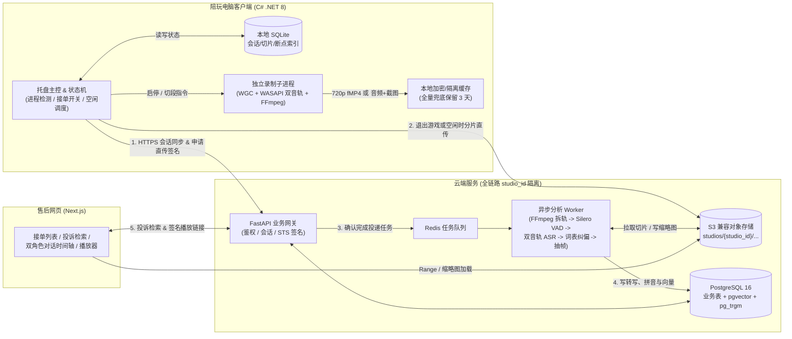
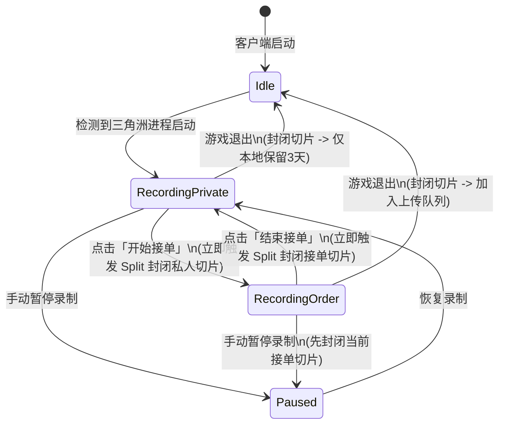

# SDD 阶段 1：系统架构设计与任务拆解

- 版本：v1.0
- 日期：2026-11-18
- 依据文档：[requirements.md](./requirements.md)、[ADR 0001～0005](./decisions/)

---

## 1. 总体架构与核心数据流

本系统采用 **「轻量本地双轨录制端 + 对象存储直传 + 云端异步双音轨语义流水线 + 售后 Web 工作台」** 架构，严格遵守反作弊安全红线与全链路 `studio_id` 租户隔离。



### 核心业务闭环
1. **自动兜底录制**：检测到《三角洲行动》进程启动后，客户端拉起独立录制子进程，通过 `Windows.Graphics.Capture` + `WASAPI` 分别采集游戏画面、Track 1（麦克风）、Track 2（系统声音），按固定时长（默认 5 分钟）滚动写入本地缓存，全量本地保留 3 天。
2. **接单切段物理隔离**：陪玩师点击「开始接单 / 结束接单」时，主控立即向录制子进程发送切段信号，封闭当前切片并开启新切片，确保私人局与接单局从文件物理层面完全分离。
3. **游戏零干扰后台续传**：只有接单切片进入上传队列；且上传器仅在**游戏未运行**（退游或电脑空闲）时通过 HTTPS 分片直传至对象存储；游戏一旦启动立即挂起上传并记录已传分片 `ETag`。
4. **双音轨异步转写与混合检索**：切片上传完成后触发云端 Worker：拆出双音轨 → Silero VAD 过滤静音 → 独立 ASR 转写并打上 `player` / `system` 标签 → 行业词表纠偏与拼音索引 → 滑动窗口向量化写入 `pgvector` → 抽取每 5 秒关键帧缩略图。
5. **售后定位核对**：售后人员输入投诉语句，后端通过「向量语义 + 关键词/拼音三元组」混合检索返回 Top 3～5 候选时间点（附说话人文本与缩略图），点击即跳转视频对应位置。

---

## 2. 技术栈选型

### 2.1 客户端（Windows 桌面端）
| 模块 | 选型 | 选型理由 |
|---|---|---|
| 主控与托盘壳 | **C# (.NET 8)** + WPF（托盘 `Hardcodet.NotifyIcon.Wpf` / 原生托盘 + 极简悬浮状态小窗） | 原生契合 Windows API（进程监测、`GetLastInputInfo` 空闲检测、WGC/WASAPI），部署体积小、内存易控在 200 MB 内 |
| 画面采集 | **`Windows.Graphics.Capture` (WGC)** | 微软官方现代窗口/屏幕采集接口，与 OBS 同源合规，零注入、支持 D3D11 零拷贝捕获，规避 ACE 反作弊 |
| 音频采集 | **`WASAPI`**（`NAudio` 或 C++/WinRT 封装） | 分别打开默认麦克风（Capture）与默认播放设备（Loopback），原生双路独立采样 |
| 编码与封装 | **精简裁剪版 `FFmpeg`**（独立子进程，仅保留 H.264 硬编 / AAC / Opus / WebP） | 优先探测 `h264_nvenc` / `h264_amf` / `h264_qsv` 硬件编码 `720p @ 15fps, 800kbps`；无硬编时自动降级为「双音轨 Opus/AAC + 每 3 秒一张 WebP 截图」 |
| 容器格式 | **Fragmented MP4 (`fMP4`) / MKV** | 抗异常断电/游戏崩溃损坏；双音轨作为独立 Audio Stream（Stream 1: Mic, Stream 2: System）封装在同一个切片内，浏览器亦可直接播放 |
| 本地索引 | **SQLite (`Microsoft.Data.Sqlite`)** | 事务可靠记录切片归属（私人/接单）、S3 Multipart `upload_id` 与分片 `ETag`、3 天过期清理时间戳 |

### 2.2 云端与分析流水线
| 模块 | 选型 | 选型理由 |
|---|---|---|
| 对象存储 | **S3 兼容存储**（生产：阿里云 OSS / 腾讯云 COS；本地开发：MinIO） | 客户端直传分片（Presigned URL），视频流量不经过业务服务器；原生支持 Lifecycle 到期自动删档；路径前缀强隔离 `studios/{studio_id}/...` |
| 主数据库 + 向量库 | **PostgreSQL 16 + `pgvector` + `pg_trgm`** | 单库同时承载业务关系数据、拼音模糊检索与 1024 维向量检索；所有检索 `WHERE studio_id = :sid` 一步完成租户隔离，MVP 无需运维第二套向量库 |
| 后端 API | **Python 3.12 + FastAPI + SQLAlchemy 2.0** | 与音视频、ASR、Embedding 生态同语言统一，自动生成 OpenAPI 契约供前端和客户端对齐 |
| 异步队列与 Worker | **Redis + ARQ / Celery** | 承接切片上传完成事件，调度 FFmpeg 拆轨抽帧、VAD、ASR、Embedding 入库 |
| VAD 静音过滤 | **Silero VAD**（轻量 ONNX CPU 推理） | 在调用 ASR 前精准切掉纯游戏枪声/脚步声/静默片段，彻底消除无语音时的模型幻觉，同时减少 40%~60% ASR 计费 |
| 双音轨 ASR | **云端 ASR API 优先**（如阿里云 Paraformer-v2 / 腾讯云 ASR，支持行业热词表），预留 **`faster-whisper` (`large-v3-turbo`)** 适配器 | MVP 阶段无需维护 GPU 机器；1 小时录像有效语音约 25 分钟，双轨并发转写耗时 < 1 分钟，稳妥满足「≤10 分钟可检索」 |
| 语义向量 & 混合检索 | **`bge-m3` / `text-embedding-v3`**（1024 维） + **`pypinyin`** + 行业词表纠偏 | 解决错字/同音字漏检（如「变成气」→「变声器」），结合 `pgvector` 余弦距离与 `pg_trgm` 关键词做 RRF 融合排序 |
| 关键帧缩略图 | **FFmpeg 定时抽帧（每 5 秒 1 帧，320px 宽 WebP）** | 单张约 8～12 KB，1 小时约 720 张（< 8 MB），成本极低，售后检索卡片可直接展示当时画面 |

### 2.3 售后网页端
| 模块 | 选型 | 选型理由 |
|---|---|---|
| 前端框架 | **Next.js 15 (React + TypeScript) + Tailwind CSS + shadcn/ui** | 后台工作台开发效率高，组件生态成熟，强类型契约减少联调错误 |
| 视频回放与时间轴 | **原生 HTML5 `<video>` (Range 流式加载 fMP4) + 自定义双角色对话时间轴** | 支持点击候选时间点毫秒级 `currentTime` 跳转；支持鼠标悬停时间轴预览缩略图；支持分别静音/聚焦陪玩或系统音轨（Web Audio API 或转码辅助音轨） |

---

## 3. 客户端内部架构与关键机制

### 3.1 状态机与物理分段隔离


- **物理切片策略**：
  - 正常录制每 **5 分钟** 自动滚动切分一个切片，单切片 720p 约 30～40 MB。
  - 状态切换（开始接单 / 结束接单 / 暂停 / 退游）时**立即发送 Split 指令**封闭当前切片，确保私人局画面绝对不会混入接单切片文件。
  - 降级模式（无硬编）：仅录双音轨 Opus/AAC（约 96 kbps 总码率，5 分钟仅 ~3.6 MB）+ 每 3 秒截取 1 张 720p WebP 截图，打包为切片目录随任务上传。

### 3.2 闲置后台上传调度与游戏零干扰
- **触发条件**：后台调度器每 10 秒检查一次：
  1. 目标游戏进程未在运行；
  2. 满足「已退游超过 30 秒」或「`GetLastInputInfo` 键鼠空闲 > 60 秒」；
  3. 队列存在 `upload_status IN ('pending', 'uploading', 'paused')` 的接单切片或手动补传切片。
- **游戏抢占挂起**：一旦进程监测器发现《三角洲行动》启动，立即取消正在进行的 HTTP 分片上传请求（释放全部上行带宽），将当前已完成的 `PartNumber + ETag` 持久化至 SQLite，等下次退游/空闲后从下一分片续传。

### 3.3 漏点接单授权补传
- 客户端「本地录像记录」界面展示最近 3 天内 `is_order = false` 的录制时段列表。
- 陪玩师勾选指定时段并选填订单号/备注，弹窗二次确认授权后，客户端将该时段涉及的本地切片标记为 `is_manual_backfill = true` 并关联新创建的 `session_id`，入队等待空闲上传。

### 3.4 进程检测与热配置
- 客户端不写死唯一进程名，启动与心跳时从 `/api/v1/client/config` 拉取匹配规则（进程名列表 + 主窗口特征），同时支持本地内置默认配置，确保游戏更新或不同启动器（WeGame / 官方启动器）下无需重新发版即可生效。

---

## 4. 核心数据模型（PostgreSQL + `pgvector`）

> 所有业务表强制包含 `studio_id`（`UUID`），索引均以 `studio_id` 为前导列，服务端 Repository 层强制注入租户上下文过滤。

```sql
CREATE EXTENSION IF NOT EXISTS vector;
CREATE EXTENSION IF NOT EXISTS pg_trgm;

-- 1. 工作室租户表
CREATE TABLE studios (
    id              UUID PRIMARY KEY,
    name            VARCHAR(100) NOT NULL,
    retention_days  INT NOT NULL DEFAULT 30,          -- 云端接单录像保留天数
    status          VARCHAR(20) NOT NULL DEFAULT 'active',
    created_at      TIMESTAMPTZ NOT NULL DEFAULT now()
);

-- 2. 用户表（陪玩师 / 售后 / 管理员）
CREATE TABLE users (
    id              UUID PRIMARY KEY,
    studio_id       UUID NOT NULL REFERENCES studios(id),
    username        VARCHAR(64) NOT NULL,
    display_name    VARCHAR(64) NOT NULL,
    role            VARCHAR(20) NOT NULL,             -- 'player' | 'aftersales' | 'admin'
    password_hash   TEXT NOT NULL,
    status          VARCHAR(20) NOT NULL DEFAULT 'active',
    created_at      TIMESTAMPTZ NOT NULL DEFAULT now(),
    UNIQUE (studio_id, username)
);

-- 3. 客户端设备表
CREATE TABLE devices (
    id              UUID PRIMARY KEY,
    studio_id       UUID NOT NULL REFERENCES studios(id),
    player_id       UUID NOT NULL REFERENCES users(id),
    device_fp       VARCHAR(128) NOT NULL,            -- 机器指纹
    gpu_encoder     VARCHAR(32) NOT NULL DEFAULT 'unknown', -- 'nvenc' | 'amf' | 'qsv' | 'none'
    client_version  VARCHAR(32) NOT NULL,
    last_seen_at    TIMESTAMPTZ NOT NULL DEFAULT now(),
    UNIQUE (studio_id, player_id, device_fp)
);

-- 4. 接单会话表（MVP 按陪玩账号 + 起止时间 + 可选订单备注归档）
CREATE TABLE order_sessions (
    id                  UUID PRIMARY KEY,             -- 客户端生成 UUID，保障离线幂等上报
    studio_id           UUID NOT NULL REFERENCES studios(id),
    player_id           UUID NOT NULL REFERENCES users(id),
    device_id           UUID NOT NULL REFERENCES devices(id),
    order_ref           VARCHAR(128),                 -- 可选订单号
    note                VARCHAR(500),                 -- 可选备注
    status              VARCHAR(24) NOT NULL DEFAULT 'recording', -- 'recording' | 'ended'
    is_manual_backfill  BOOLEAN NOT NULL DEFAULT FALSE, -- 是否漏录手动授权补传
    started_at          TIMESTAMPTZ NOT NULL,
    ended_at            TIMESTAMPTZ,
    expires_at          TIMESTAMPTZ,                  -- 按 studio.retention_days 计算
    created_at          TIMESTAMPTZ NOT NULL DEFAULT now()
);
CREATE INDEX idx_sessions_studio_player_time
    ON order_sessions (studio_id, player_id, started_at DESC);
CREATE INDEX idx_sessions_studio_order_ref
    ON order_sessions (studio_id, order_ref) WHERE order_ref IS NOT NULL;

-- 5. 录像切片表
CREATE TABLE media_segments (
    id              UUID PRIMARY KEY,                 -- 客户端生成 UUID
    studio_id       UUID NOT NULL REFERENCES studios(id),
    session_id      UUID NOT NULL REFERENCES order_sessions(id) ON DELETE CASCADE,
    seq_no          INT NOT NULL,                     -- 会话内序号 1,2,3...
    codec_mode      VARCHAR(24) NOT NULL,             -- 'video_hw' | 'audio_screenshots'
    storage_key     TEXT NOT NULL,                    -- studios/{studio_id}/players/{player_id}/sessions/{session_id}/seg_{seq}.mp4
    s3_upload_id    TEXT,                             -- Multipart Upload ID（断点续传用）
    file_size       BIGINT NOT NULL,
    sha256          CHAR(64) NOT NULL,
    duration_ms     INT NOT NULL,
    upload_status   VARCHAR(24) NOT NULL DEFAULT 'init',   -- 'init' | 'completed'
    asr_status      VARCHAR(24) NOT NULL DEFAULT 'pending', -- 'pending' | 'processing' | 'done' | 'failed'
    started_at      TIMESTAMPTZ NOT NULL,
    ended_at        TIMESTAMPTZ NOT NULL,
    created_at      TIMESTAMPTZ NOT NULL DEFAULT now(),
    UNIQUE (session_id, seq_no)
);
CREATE INDEX idx_segments_studio_session
    ON media_segments (studio_id, session_id, seq_no);

-- 6. 双音轨转写句子表
CREATE TABLE transcript_utterances (
    id              BIGSERIAL PRIMARY KEY,
    studio_id       UUID NOT NULL,
    session_id      UUID NOT NULL REFERENCES order_sessions(id) ON DELETE CASCADE,
    segment_id      UUID NOT NULL REFERENCES media_segments(id) ON DELETE CASCADE,
    speaker         VARCHAR(16) NOT NULL,             -- 'player' (Track 1) | 'system' (Track 2)
    start_ms        INT NOT NULL,                     -- 相对于 session 起点毫秒偏移
    end_ms          INT NOT NULL,
    raw_text        TEXT NOT NULL,
    normalized_text TEXT NOT NULL,                    -- 词表纠偏后文本
    pinyin_text     TEXT NOT NULL                     -- 无声调拼音，支持模糊匹配
);
CREATE INDEX idx_utterances_studio_session_time
    ON transcript_utterances (studio_id, session_id, start_ms);
CREATE INDEX idx_utterances_pinyin_trgm
    ON transcript_utterances USING gin (pinyin_text gin_trgm_ops);

-- 7. 语义检索窗口切片表（30s 窗口，10s 重叠）
CREATE TABLE transcript_chunks (
    id              BIGSERIAL PRIMARY KEY,
    studio_id       UUID NOT NULL,
    session_id      UUID NOT NULL REFERENCES order_sessions(id) ON DELETE CASCADE,
    segment_id      UUID NOT NULL REFERENCES media_segments(id) ON DELETE CASCADE,
    start_ms        INT NOT NULL,
    end_ms          INT NOT NULL,
    combined_text   TEXT NOT NULL,                    -- "[陪玩] ... \n[老板/系统] ..."
    thumbnail_key   TEXT,                             -- 窗口中点附近关键帧缩略图对象存储 Key
    embedding       vector(1024) NOT NULL
);
CREATE INDEX idx_chunks_studio_session
    ON transcript_chunks (studio_id, session_id);
CREATE INDEX idx_chunks_embedding_hnsw
    ON transcript_chunks USING hnsw (embedding vector_cosine_ops);

-- 8. 售后核对记录表
CREATE TABLE aftersales_cases (
    id              UUID PRIMARY KEY,
    studio_id       UUID NOT NULL REFERENCES studios(id),
    session_id      UUID NOT NULL REFERENCES order_sessions(id),
    handler_id      UUID NOT NULL REFERENCES users(id),
    complaint_text  TEXT NOT NULL,
    matched_points  JSONB NOT NULL,                   -- 检索返回的时间点与摘要快照
    verdict_note    TEXT,                             -- 人工判断结果备注
    status          VARCHAR(24) NOT NULL DEFAULT 'open', -- 'open' | 'resolved'
    created_at      TIMESTAMPTZ NOT NULL DEFAULT now()
);
CREATE INDEX idx_cases_studio_session
    ON aftersales_cases (studio_id, session_id, created_at DESC);
```

---

## 5. 客户端 - 云端接口契约

### 5.1 通用约定
- 协议：全量 HTTPS + JSON（`Content-Type: application/json`），错误统一返回 `{ "code": "ERR_...", "message": "..." }`。
- 鉴权：`Authorization: Bearer <access_token>`，JWT Claims 强制绑定 `studio_id`、`user_id`、`role`、`device_id`，**客户端不直接传 `studio_id` 越权覆盖**，由后端从 Token 解析。
- 幂等性：离线补报会话/初始化上传均携带客户端生成的 `UUID`，服务端按主键做幂等 `UPSERT`。

### 5.2 客户端核心接口

#### 1) 客户端登录与配置拉取
- **`POST /api/v1/auth/client-login`**
  - Request: `{ "studio_code": "pilot_01", "username": "pw001", "password": "...", "device_fp": "sha256-...", "gpu_encoder": "nvenc", "client_version": "0.1.0" }`
  - Response: `{ "access_token": "...", "refresh_token": "...", "expires_in": 86400, "player": { "id": "...", "display_name": "阿泽", "studio_id": "..." } }`
- **`GET /api/v1/client/config`**
  - Response:
    ```json
    {
      "target_processes": ["DeltaForceClient-Win64-Shipping.exe"],
      "segment_duration_sec": 300,
      "local_retention_days": 3,
      "upload_part_size_bytes": 5242880,
      "idle_threshold_sec": 60,
      "post_exit_delay_sec": 30
    }
    ```

#### 2) 接单会话同步（支持离线后补报）
- **`POST /api/v1/client/sessions`**
  - Request:
    ```json
    {
      "session_id": "a9b1c2d3-...",
      "order_ref": "BX20261118001",
      "note": "护航两把绝密航天",
      "is_manual_backfill": false,
      "started_at": "2026-11-18T14:00:00+08:00",
      "ended_at": "2026-11-18T15:12:30+08:00"
    }
    ```
  - 说明：`ended_at` 可空（进行中先上报，结束后再调用 `finish`；若离线完成则可一次性携带 `ended_at` 幂等创建）。
- **`PATCH /api/v1/client/sessions/{session_id}/finish`**
  - Request: `{ "ended_at": "2026-11-18T15:12:30+08:00" }`

#### 3) 分片初始化与断点续传
- **`POST /api/v1/client/segments/init-upload`**
  - Request:
    ```json
    {
      "segment_id": "f47ac10b-...",
      "session_id": "a9b1c2d3-...",
      "seq_no": 1,
      "codec_mode": "video_hw",
      "file_size": 36700160,
      "sha256": "e3b0c44298fc1c149afbf4c8996fb924...",
      "duration_ms": 300000,
      "started_at": "2026-11-18T14:00:00+08:00",
      "ended_at": "2026-11-18T14:05:00+08:00"
    }
    ```
  - Response:
    ```json
    {
      "already_completed": false,
      "upload_id": "s3-multipart-upload-id",
      "part_size": 5242880,
      "uploaded_parts": [
        { "part_number": 1, "etag": "\"9bb58f26192e4ba00f01e2e7b136bbd8\"" }
      ],
      "presigned_parts": [
        { "part_number": 2, "url": "https://oss.../partNumber=2&..." },
        { "part_number": 3, "url": "https://oss.../partNumber=3&..." }
      ]
    }
    ```
  - 说明：若上次上传被游戏启动中断，客户端重新调用 `init-upload` 时服务端查询 S3 `ListParts` 返回 `uploaded_parts` 及剩余 `presigned_parts`，实现真正跨重启断点续传。

- **`POST /api/v1/client/segments/{segment_id}/complete-upload`**
  - Request:
    ```json
    {
      "parts": [
        { "part_number": 1, "etag": "\"...\"" },
        { "part_number": 2, "etag": "\"...\"" }
      ]
    }
    ```
  - Response: `{ "segment_id": "...", "upload_status": "completed", "asr_status": "pending" }`
  - 服务端校验文件大小与分片完整后调用 S3 `CompleteMultipartUpload`，随后向 Redis 队列投递异步分析任务。

### 5.3 售后 Web 端核心接口
- `GET /api/v1/aftersales/sessions?player_id=&order_ref=&from=&to=&page=`：分页检索所属工作室的接单会话及分析状态（`asr_progress`）。
- `POST /api/v1/aftersales/sessions/{session_id}/search`：输入 `{ "complaint": "陪玩态度敷衍还开变声器" }`，执行混合检索并返回 Top 3～5 候选时间点：
  ```json
  {
    "session_id": "...",
    "candidates": [
      {
        "start_ms": 1420000,
        "end_ms": 1450000,
        "score": 0.89,
        "match_reason": "语义匹配 + 命中热词「变声器」",
        "snippet": "[老板/系统] 你是不是开变声器了怎么声音一卡一卡的\n[陪玩] 没开啊这麦就这样...",
        "thumbnail_url": "https://oss.../thumb_1435s.webp?Expires=..."
      }
    ]
  }
  ```
- `GET /api/v1/aftersales/sessions/{session_id}/playback`：返回各切片签名播放 URL（有效期 1 小时）、双角色完整转写时间轴与缩略图索引，供前端连续/跳转播放。
- `POST /api/v1/aftersales/cases`：保存售后人工核对记录与备注。
- `POST /api/v1/aftersales/match-evidence`：单局辱骂证据分析（已实现），契约见 [match-evidence.md](match-evidence.md#http-接口)。

---

## 6. Milestone 开发任务拆解

优先跑通**「客户端本地自动录屏 + 双音轨 + 后台上传」**最小闭环，再完成云端语义流水线与售后工作台联调。

### M0：环境实机探测与工程骨架（1～2 天）
- **任务**：
  1. 在真实 Windows 电脑上运行《三角洲行动》，采集准确进程名、窗口类名与反作弊兼容性基线（确认 Q4）；调研试点电脑显卡覆盖率（确认 Q5）。
  2. 初始化仓库目录：`client/`（.NET 8 解决方案）、`server/`（FastAPI + Worker）、`web/`（Next.js）、`infra/`（Docker Compose：PostgreSQL+pgvector、Redis、MinIO）。
- **验收标准**：本地 `docker compose up` 一键拉起 Postgres/pgvector、Redis、MinIO；确认真实游戏进程名与 WGC 采集画面黑屏/权限问题已验证通过。

### M1：客户端本地自动录屏 + 双音轨最小闭环（第 1 周，最高优先级）
- **任务**：
  1. 实现 `PeiwanAgent.Tray`：进程轮询检测启停、托盘图标与「私人录制 / 接单录制」悬浮状态提示、全局快捷键/一键「开始/结束接单」开关（可选填订单号/备注）。
  2. 实现 `PeiwanRecorder.Worker`：`Windows.Graphics.Capture` 抓帧 + `WASAPI` 双路独立采样（Track 1 麦克风 / Track 2 系统回环）+ 精简 FFmpeg 封装双音轨 720p fMP4；实现无硬编时降级「双音轨 + 低帧率截图」逻辑。
  3. 实现接单状态切换物理切段（Split）、本地 SQLite 状态索引与 3 天自动过期清理。
- **验收标准**：启动游戏自动录屏、退出自动停止；点击开始/结束接单生成独立物理文件；用播放器/FFprobe 验证切片内含 2 条清晰独立音轨；真机游戏实测 CPU ≤3%、内存 ≤200 MB、无跳 ping 掉帧且未触发 ACE 异常提示。

### M2：客户端闲置后台断点续传与漏录补传（第 2 周）
- **任务**：
  1. 实现服务端 `client-login`、`config`、`sessions`、`init-upload`、`complete-upload` 接口及 MinIO/S3 预签名分片直传。
  2. 实现客户端后台上传调度器：仅接单切片入队、游戏运行期强制挂起、退游或空闲自动续传、断网/重启断点恢复。
  3. 实现客户端「3 天内本地私人片段查看与显式授权手动补传」面板。
- **验收标准**：模拟接单中退出游戏 → 自动分片上传至 MinIO；上传中途启动游戏 → 上传毫秒级挂起；再次退游 → 从断点分片继续上传完成并校验 SHA256 一致；私人局切片默认 0 上传，手动授权后可补传。

### M3：云端双音轨 ASR + 混合语义检索流水线（第 2～3 周）

单局辱骂取证采用[单局证据分析契约](match-evidence.md)。快速混合检索继续用于投诉定位，按局计数由全量判定流程生成。
- **任务**：
  1. 实现分析 Worker：FFmpeg 拆出双音轨 + 每 5 秒 WebP 关键帧抽帧上传对象存储。
  2. 集成 Silero VAD 静音裁剪 + 云端 ASR API 双轨独立转写（带热词表）。
  3. 实现行业词表同音纠偏、`pypinyin` 拼音索引、30s 滑动窗口切片、Embedding 向量化入库 `pgvector`，以及混合检索 + RRF 排序接口。
- **验收标准**：1 小时双音轨接单录像从上传完成到可检索 ≤10 分钟；静音段无 ASR 幻觉文本；`studio_id` 跨租户隔离单元测试全通过。

### M4：售后 Web 工作台与标准测试集验收（第 4 周）
- **任务**：
  1. 构建 Next.js 售后工作台：租户登录、接单会话筛选列表、投诉输入与候选时间点卡片（含缩略图与说话人片段）、视频播放器精确跳转与双角色时间轴高亮、加载/无结果/错误三态处理。
  2. 整理 10～20 段标注好纠纷时间点的《三角洲行动》双音轨录屏作为标准答案集，跑端到端检索评估与试点工作室联调。
- **验收标准**：标准测试集前 3 个候选结果命中正确时间点比例 ≥80%；售后人员可在网页端流畅跳转核对并保存核对记录。
